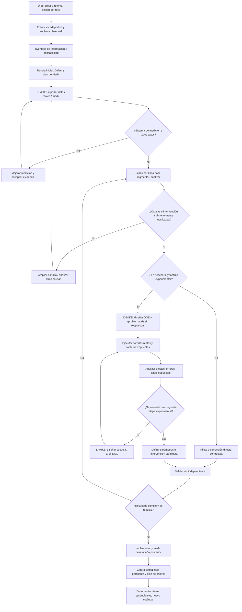

# D-MIKE — Especificación maestra de rediseño para Claude

**Objetivo:** mejorar conjuntamente (1) el artefacto web de Diagnóstico en línea, (2) D-MIKE de escritorio, (3) el manual de uso y (4) el caso maestro, para que sea posible ejecutar un proyecto DMAIC con **datos reales adquiridos progresivamente**, sin precargar resultados de experimentos aún no realizados.

**Material primario obligatorio:** `D-MIKE_Manual_de_uso_v025.pdf` (versión 0.25.0, 138 páginas). Usar también el repositorio/código fuente del artefacto web, del aplicativo D-MIKE y el generador del manual, **cuando el usuario los proporcione**. No afirmar haber visto ni modificado código que no esté disponible.

**Naturaleza del documento:** especificación de requisitos y plan de implementación; distingue hechos documentados del comportamiento **propuesto**. Las rutas y las funciones marcadas «actual» proceden del manual. Las decisiones de arquitectura deben corroborarse con el código.

---

## 1. Instrucciones de ejecución para Claude

Actúa como arquitecto de software, desarrollador full stack, ingeniero de calidad, Master Black Belt, especialista DOE y redactor técnico. Tu trabajo es transformar la especificación en cambios verificables en las tres piezas del producto y en una documentación consistente.

1. Antes de modificar archivos, inspecciona el repositorio, identifica la arquitectura, el contrato de receta, los esquemas de datos, las pruebas, el flujo de compilación y el origen del manual.
2. Levanta una **matriz AS-IS / TO-BE** para cada funcionalidad. Conservar funcionalidades probadas que ya existan. No sustituir todo el sistema de recetas si puede extenderse.
3. Distingue **implementado**, **documentado pero no verificado en código**, **a desarrollar** y **propuesto para después**. No inventes rutas, funciones, archivos o pantallas.
4. Ejecuta en orden seguro: diagnóstico → plan de cambios → implementación incremental → pruebas → actualización del manual → verificación de correspondencia.
5. No introduzcas valores aleatorios ni datos ficticios en proyectos marcados como *reales*. El generador sintético debe quedar exclusivamente dentro de la modalidad *demostración*.
6. Evita cambios destructivos. Usa migraciones compatibles, preserva el folio, el `.dmike`, los datos importados y los resultados históricos.
7. Escribe en español los textos de interfaz y la documentación; conserva los términos técnicos e identificadores de programación cuando corresponda.
8. Entrega código completo de los archivos modificados o commits/diffs íntegros reproducibles; no fragmentos sueltos. Presenta pruebas ejecutadas con resultados y problemas pendientes.
9. Si falta el código o algún insumo esencial, **no simules la implementación**. Entrega el análisis realizable, la especificación técnica, las dependencias y las pruebas previstas.

## 2. Diagnóstico: qué dice realmente el manual v0.25.0

### 2.1 Capacidades presentes en la documentación

En el **capítulo 5, página impresa 106**, el manual define la receta como declarativa: contiene datos y parámetros, no código, y D-MIKE la valida contra el catálogo. Una receta puede incluir folio, perfil DMAIC, hojas y columnas, diseños experimentales con semilla, formatos, análisis configurados, avance y recomendaciones.

El **Diagnóstico en línea** inicia o retoma una sesión por folio y dispone de cinco secciones: *Diagnóstico*, *Datos del proyecto*, *Asistente*, *Datos a reunir* y *Llevar a D-MIKE*. El botón **Preparar la receta** valida contra el catálogo y exporta una plantilla de Excel (con receta en hoja oculta) y un TXT con instrucciones/folio.

En **Archivo › Proyecto › Abrir proyecto…**, D-MIKE ofrece: (a) ejecutar la receta en proyecto nuevo; (b) actualizar un proyecto abierto con el mismo folio, agregando solo información nueva, sin sobrescribir columnas con datos o campos escritos y sin repetir análisis corridos; (c) abrir solo los datos. **Los análisis sin datos pueden quedar pendientes.** Las columnas se enlazan por nombre y el sistema rechaza respuestas de DOE cuyas corridas no coincidan.

**Implicación:** ya existe la base para **recetas parciales e incrementales**. Hay que aprovecharla y verificar su comportamiento efectivo en el código, no reinventarla por defecto.

### 2.2 Limitaciones del caso maestro actual

El **capítulo 6, páginas impresas 107–127**, desarrolla un ejemplo **hipotético** de resistencia de uniones adhesivas epóxicas en paneles compuestos. El cliente requiere al menos **30 MPa** (límite inferior de especificación). El archivo `herramientas/generar_caso_integral.py`, mencionado en el manual, usa la semilla 2026 y ecuaciones conocidas para producir seis series de datos:

| Conjunto | Tamaño documentado | Estado temporal en un proyecto real |
|---|---:|---|
| 01 Línea base | 100 observaciones | Se obtiene al medir el estado inicial |
| 02 Defectos | 86 registros | Se obtiene de inspección y rechazos |
| 03 Gage R&R | 60 mediciones | Se obtiene después de diseñar y ejecutar el estudio de medición |
| 04 Cribado | 11 corridas | Se obtiene después de diseñar y **ejecutar** un DOE de cribado |
| 05 Diseño central compuesto | 13 corridas | Se obtiene solo si los resultados previos justifican optimizar |
| 06 Después | 60 observaciones | Se obtiene después de implementar y vigilar la mejora |

En la demostración, los resultados son deliberadamente detectables: lote L3, efecto de temperatura y tiempo, interacción y curvatura. Esto es válido como **prueba docente o de regresión de software**, pero **no** como procedimiento de adquisición de datos reales.

El propio manual describe, en **6.6 Mejorar (páginas 118–123)**, primero un factorial fraccionado `2^(4−1)` de resolución IV con tres centros (11 corridas), después un DCC rotable con cuatro puntos factoriales, cuatro axiales y cinco centrales (13 corridas). En **6.9–6.10 (páginas 126–127)** propone cautelas: orden Medir→Analizar→Mejorar, necesidad de validación, proceso inestable, diferencia entre valor planteado y medido, confirmación independiente y precauciones respecto a predicción.

**Problema a resolver:** no debe exigirse que un usuario que inicia un proyecto tenga ya las respuestas del DOE de cribado, del DCC o de las 60 observaciones posteriores. Asimismo, no debe imponerse una ruta de dos DOE cuando quizá una corrección de proceso, una sola experimentación o únicamente investigación adicional sea suficiente.

### 2.3 Aclaración estadística esencial

Las dos etapas de DOE **no son erróneas por sí mismas**: son una estrategia secuencial válida. Lo incorrecto sería exigir sus **datos de respuesta anticipadamente** o presentar la segunda como obligatoria. Debe distinguirse: **diseño experimental** (factores, niveles y matriz de corridas preparada antes de ejecutar) de **resultados experimentales** (respuestas observadas después).

En ensayos destructivos, no presupongas que probetas gemelas equivalen a medir repetidamente la misma pieza: el estudio del sistema de medición necesita un diseño coherente con el ensayo. No inventes un límite superior de tolerancia: el caso especifica solo el límite inferior de **30 MPa**. No conviertas automáticamente un R² bajo en justificación suficiente para un DOE; considera viabilidad, riesgo y pregunta causal. No concluyas que `AB` es definitivamente temperatura×tiempo si hay alias `AB = CD`: busca evidencia adicional o una etapa que resuelva confusión.

---

## 3. Modelo objetivo: receta evolutiva con evidencia progresiva

La sesión web y el archivo `.dmike` deben permitir que un proyecto avance mediante **estados verificables**, con actualizaciones no destructivas. Las versiones V1/V2/V3 indican madurez lógica, **no proyectos distintos**.



### Reglas de negocio

- Cada actualización conserva **folio, identificador de proyecto, procedencia de datos y decisiones**.
- Un proyecto real **nunca** genera respuestas sintéticas silenciosamente.
- Todo análisis sin los datos mínimos requeridos permanece **pendiente**, con explicación legible.
- Una fase puede reabrirse por evidencia nueva, sin eliminar la historia.
- El sistema no debe avanzar porque «todas las casillas estén marcadas» si los criterios de evidencia no se cumplen.
- El DOE se **diseña** en el software antes de la recolección; sus respuestas se importan/capturan **después**.
- El usuario debe poder **omitir** cribado, DCC o DOE completo con un motivo registrado.
- No presentar métricas, significancias, efectos, parámetros óptimos ni beneficios como confirmados antes de medirlos.

## 4. Rediseño del artefacto web: preguntas y decisiones

Mantener como punto de partida las cinco secciones existentes si el código las confirma. Sustituir un formulario estático por un **cuestionario condicional**.

### 4.1 Entrevista inicial mínima — Definir

1. ¿Qué producto, documento, servicio o proceso deseas mejorar?
2. ¿Qué desviación has observado y dónde ocurre?
3. ¿Qué exige el cliente o el negocio? ¿Existe especificación verificable?
4. ¿Desde cuándo sucede? ¿Con qué frecuencia aproximada, si se conoce?
5. ¿Quién es dueño del proceso? ¿Qué personas y áreas intervienen?
6. ¿Qué riesgos, costos o entregables puede afectar?
7. ¿Qué capacidad de acceso a datos y permisos de medición tiene el equipo?

**Salida:** problema y objetivo **provisionales**, alcance, stakeholders, requisitos, proyecto y folio, más interrogantes por resolver. Ninguna cifra ficticia.

### 4.2 Inventario de evidencia — Medir

Para cada variable candidata preguntar: `¿Existe el dato?`, `¿Dónde?`, `¿Quién lo captura?`, `¿Qué representa?`, `¿Unidad?`, `¿Periodo?`, `¿Identificador de unidad?`, `¿Se puede importar?`, `¿Se verificó la calidad de medición?`.

Clasificar cada campo:

- `REAL_VERIFICADO`: observado, origen documentado y validez revisada.
- `REAL_NO_VALIDADO`: existe, falta revisar calidad o definición.
- `PENDIENTE_RECOLECCION`: debe levantarse con una instrucción específica.
- `DESCONOCIDO`: no se sabe si existe o dónde obtenerlo.
- `NO_APLICA`: decisión justificada.
- `SINTETICO_DEMO`: solo permitido para demostración, con identificación inequívoca.

La entrevista debe solicitar **unidad de análisis** (panel, probeta, lote, ciclo, documento, tarea, persona-hora, etc.), fuente, fechas, grupos o estratos y regla de aceptación. No presumir que las mediciones repetidas son independientes.

### 4.3 Preguntas durante Analizar

- ¿La línea base representa la diversidad de lotes, turnos, equipos y periodos?
- ¿Existe evidencia de inestabilidad o cambios de sistema?
- ¿Qué factores controlables y de ruido podrían afectar la respuesta?
- ¿Qué evidencia hay contra cada hipótesis?
- ¿Son suficientes los datos o es necesario muestrear más?
- ¿Hay intervenciones directas justificadas que no requieran experimentación?

**Salida:** hipótesis y evidencia, incertidumbres, análisis pendientes y decisión documentada; no declaraciones automáticas de causalidad.

### 4.4 Preguntas previas a DOE — Mejorar

El artefacto no debe pedir «los resultados del DOE» como condición previa. Debe preguntar:

1. ¿Qué **respuesta Y** se quiere optimizar y cuál es su medición confiable?
2. ¿Qué factores **X** pueden alterarse deliberadamente y quién autoriza hacerlo?
3. ¿Cuál es el rango **técnicamente admisible** de cada factor?
4. ¿Qué parámetros deben fijarse, bloquearse o vigilarse?
5. ¿Qué costos, tiempos, materiales y riesgos tiene cada corrida?
6. ¿Hay aleatorización, réplicas y bloqueo viables? ¿Existen restricciones de orden?
7. ¿Es necesario un cribado, un diseño de caracterización, uno de optimización, un piloto no experimental o nada de lo anterior?
8. ¿Qué condiciones obligan a detener los experimentos?

**Salida:** expediente de diseño y criterios de aprobación. El **software** genera la matriz DOE, sus identificadores y el orden de ejecución. Solo después se habilita la captura de respuestas.

### 4.5 Retoma de sesión web

Al regresar, el artefacto ofrece rutas según el estado: `Sin datos`, `Históricos cargados`, `Sistema de medición evaluado`, `Línea base completa`, `Causas investigadas`, `DOE diseñado`, `DOE ejecutado`, `Mejora validada`, `Control en marcha`. Pregunta únicamente por información nueva o pendientes relevantes.

No es necesario guardar toda la información sensible en la web: permitir una importación explícita de un **paquete de avance** desde D-MIKE que resuma resultados, metadatos y decisiones sin exponer información confidencial innecesaria.

## 5. Contrato lógico de receta incremental

**Propuesta de esquema conceptual, NO descripción del JSON actual.** Adaptarlo al contrato real después de inspeccionar el repositorio.

```json
{
  "schema_version": "A_DEFINIR_EN_REPOSITORIO",
  "project_folio": "FOLIO-REAL",
  "project_mode": "real",
  "recipe_revision": 1,
  "base_revision": null,
  "phase": "measure_planning",
  "project_metadata": {},
  "requirements": [],
  "variables": [],
  "data_sources": [],
  "data_sets": [],
  "measurements": [],
  "analyses": [{ "module": "catalog_id", "status": "pending", "requires": [] }],
  "experiments": [],
  "decisions": [],
  "audit_trail": [],
  "generated_at": "ISO-8601"
}
```

**Semántica indispensable:**

- `project_mode`: `real` o `demonstration`.
- `recipe_revision` y control de versiones para actualizaciones idempotentes.
- Metadatos de origen: instrumento, usuario/responsable, fecha, unidad, lote/estrato, condiciones.
- Estados: pendiente, disponible, verificado, analizado, aprobado, ejecutado, cerrado; asignarlos a cada objeto pertinente, no como un único estado global confuso.
- Huella digital/checksum de los datos cuando sea útil y factible.
- Ningún merge debe borrar datos o resultados válidos sin una confirmación y copia histórica.
- Resolver conflictos entre modificaciones web/escritorio de manera explícita.
- Mantener compatibilidad con recetas antiguas y documentos `.dmike` existentes, con tests de migración.

### Reglas específicas para DOE

Conservar `design_id`, `run_id` inmutable, `standard_order`, `run_order`, semilla (si aplica), bloque, factores, niveles nominales/codificados, versión de diseño y metadatos de generación. Capturar `response`, unidad, fecha, operador/lote, estado y observaciones por `run_id`.

**Nunca** emparejar respuestas únicamente por número de fila: verificar identidad y niveles reales de factores. Rechazar desajustes o pedir resolución manual auditable. Prohibir mezclar respuestas de distintas versiones de diseño.

## 6. D-MIKE de escritorio: flujo funcional propuesto

1. **Crear/actualizar proyecto por folio** mediante la receta parcial (reutilizar la función documentada).
2. **Bandeja de tareas pendientes**: qué dato falta, por qué, a quién corresponde, acción sugerida.
3. **Importación validada**: tipos, unidades, muestras, fechas, faltantes, duplicados, procedencia y estratos; reportar errores antes del análisis.
4. **Medir**: preparación/validación de sistema de medición, línea base, estabilidad, normalidad cuando sea pertinente, capacidad y desempeño con supuestos explícitos.
5. **Analizar**: hipótesis, Pareto, Ishikawa, pruebas y modelos adecuados, residuos, tamaño de efecto, intervalos y límites de inferencia.
6. **Decisión de Mejorar**: intervención directa, piloto, DOE o recolección adicional, con motivo documentado.
7. **Asistente de DOE dentro de D-MIKE**: respuesta, factores, niveles admisibles, replicación, centros, bloqueos, aleatorización, costos y potencia cuando sea posible; generar diseño **sin respuestas**.
8. **Ejecución de DOE**: hoja de corridas con `run_id`, registro de valores reales y eventos; no saltar a análisis con datos insuficientes.
9. **Análisis de DOE**: efectos, interacción, alias, falta de ajuste/curvatura, error experimental y diagnóstico; no recomendar parámetros fuera de región autorizada.
10. **DOE secuencial optativo**: segundo DOE solo cuando el primero o la evidencia lo justifique. Evaluar DCC, factorial adicional, confirmación u otra intervención.
11. **Confirmación independiente**: plan, muestras, criterio de éxito, comparación observado-predicho e incertidumbre.
12. **Controlar**: implementación real, mediciones posteriores, reglas de control apropiadas, plan de reacción, verificación de sostenimiento y cierre.
13. **Paquete de avance opcional** para continuar entrevista web, sin sobrescribir el proyecto local.

### Ubicaciones documentadas a conservar o verificar

- `Archivo › Proyecto › Abrir proyecto…` para recetas Excel/JSON.
- `Proyecto › Proyecto › Datos fijos del proyecto…` para metadatos.
- `Proyecto › Proyecto › Abrir perfil del diagnóstico…` para perfil.
- `Estadística › Diseño de experimentos › Crear diseño de experimentos…` para crear DOE.
- `Estadística › Diseño de experimentos › Analizar superficie de respuesta…` para RSM.

En el rediseño, no inventar rutas de menú nuevas hasta confirmar el diseño UI/código. Crear rutas coherentes con la cinta existente y documentarlas tras implementarlas.

## 7. Caso maestro revisado: dos modalidades separadas

### Modalidad A — Demostración reproducible

Mantener el generador sintético `herramientas/generar_caso_integral.py` y los seis conjuntos actuales como material didáctico de pruebas. Etiquetar **SINTÉTICO / NO EMPRESARIAL** en datos, gráficas, reportes, interfaces y resultados. Conservar semilla y resultados esperados solo como baseline de test. La simulación no debe alimentar la modalidad real.

### Modalidad B — Caso real guiado, sin resultados precargados

| Paso | Evidencia real que se obtiene | Qué genera D-MIKE | Criterio de avance |
|---|---|---|---|
| 1. Definir | Requisito ≥30 MPa y problema documentado | Acta, SIPOC, CTQ, plan de medición | Requisito y alcance validados |
| 2. Revisar registros | Ensayos/defectos/temperaturas/tiempos disponibles | Base de datos trazable y evaluación de integridad | Datos interpretable o plan de captura |
| 3. Validar medición | Resultados reales de estudio adecuado para ensayo destructivo | Informe de aptitud del sistema | Medición apta o plan correctivo |
| 4. Línea base | Muestras reales representativas de lotes y periodos | Cartas/estadísticos/capacidad aplicable | Problema cuantificado, limitaciones registradas |
| 5. Analizar | Factores observados y evidencia de causas | Pareto, contrastes, modelos, matriz de causas | Decisión justificada de intervención |
| 6. Diseñar cribado, si procede | Restricciones reales de temperaturas, tiempos, presión y limpieza | **Matriz experimental sin respuestas** | Corridas autorizadas y ejecutables |
| 7. Ejecutar cribado | Resistencia medida por corrida; eventos/lotes | Efectos, alias, error, diagnóstico | Evidencia interpretable o repetir/ajustar |
| 8. Diseñar segunda etapa, si procede | Resultados del primer experimento y región segura | DCC u otro diseño **sin respuestas** | Justificación y aprobación |
| 9. Ejecutar/analizar etapa 2 | Resultados reales, posible porosidad | Superficie/optimizador con incertidumbre | Parámetros candidatos dentro de región |
| 10. Confirmar | Corridas independientes en condiciones propuestas | Comprobación de predicción y especificaciones | Resultado aceptable en condiciones reales |
| 11. Implementar | Registros de cambio y operación | Procedimiento, AMEF actualizado, control | Implementación autorizada |
| 12. Controlar y cerrar | Datos posteriores independientes | Estabilidad, capacidad válida y cierre | Mejora sostenida y trazable |

### Puntos críticos a corregir o aclarar en el nuevo caso

- Las 100 observaciones de línea base y 86 defectos **no son requisitos obligatorios** del caso real; son los tamaños del caso sintético. El plan de muestreo debe justificarse.
- No establecer «18 % de defectos» como hecho si la medición arroja otra cifra: el manual admite la discordancia entre 18 % en el acta y 26 % medido.
- El estudio de medición para **ensayo destructivo** no equivale necesariamente al Gage R&R cruzado convencional; verificar diseño estadístico y homogeneidad de probetas.
- Con especificación **solo inferior**, no introducir límite superior inventado para construir un % de tolerancia.
- Cuando un proceso está inestable, los índices de capacidad deben interpretarse con advertencia: no prometer desempeño futuro estable.
- No interpretar la interacción `AB` como definitivamente causal si está confundida con `CD`.
- No fijar presión/limpieza automáticamente solo por p-valores altos en 11 corridas; considerar potencia, tamaño de efecto y relevancia técnica.
- Los extremos axiales del DCC deben respetar las restricciones reales (el ejemplo lleva temperatura aproximadamente de 110.9 a 139.1 °C con supuesto máximo de 140 °C).
- Las recomendaciones calculadas por un optimizador deben confirmarse **antes** de cambiar instrucciones de trabajo.
- Separar ensayos de confirmación de la serie rutinaria posterior al cambio.
- No confundir R² de ajuste con capacidad predictiva: el manual cita un R² de predicción moderado para resistencia.

## 8. Actualización precisa del manual

Revisar todas las referencias cruzadas, rutas de menú, capturas, parámetros, tablas, ejemplos y numeración de página. Redactar nuevas instrucciones basadas en **el comportamiento realmente implementado**.

| Sección | Cambio documental |
|---|---|
| Capítulo 1 | Introducir modos *Demostración* y *Proyecto real guiado* |
| Capítulo 2 | Explicar estados, versiones de receta, datos de origen y reanudación |
| Capítulo 3 | Diferenciar resultados sintéticos/reales, validación de datos, reproducibilidad y trazabilidad |
| Capítulo 4 | Actualizar fichas de módulos afectados, dependencias, criterios y capturas |
| Capítulo 5 | Reescribir entrevista web adaptativa, recetas incrementales, merge, conflictos, exportación y paquete de avance si existe |
| Capítulo 6 | Mantener el ejemplo sintético explícitamente como tutorial reproducible, corregir inconsistencias ya reconocidas |
| Nuevo capítulo o sección | Desarrollar **Caso real guiado paso a paso**, con capturas vacías, datos adquiridos por etapas, DOE opcional y decisiones alternativas |
| Apéndices | Esquema de estados, columnas mínimas, diccionario de datos, contrato de receta, reglas DOE y resolución de errores |

El nuevo caso práctico no debe inventar datos de una empresa. Puede incluir *formatos vacíos* y ejemplos ilustrativos claramente etiquetados, pero sus resultados deben depender de lo que el usuario mida. El caso didáctico original puede permanecer como test de reproducibilidad del software.

## 9. Secuencia de implementación recomendada

### Entrega 0: auditoría técnica
- Inventariar artefacto web, esquema JSON/Excel, app, módulos DOE, manual y pruebas existentes.
- Crear matriz AS-IS/TO-BE y mapa de dependencias.
- Definir migración y compatibilidad hacia atrás.

### Entrega 1: separación real/demostración
- Distinguir modos en sesión, proyecto y datos.
- Bloquear la creación accidental de resultados sintéticos en modo real.
- Preservar el caso sintético actual y sus tests.

### Entrega 2: entrevista y receta inicial
- Implementar preguntas progresivas, estados de evidencia y pendientes.
- Exportar receta parcial y actualizar por folio sin pérdida de datos.
- Probar proyecto real sin mediciones disponibles.

### Entrega 3: DOE progresivo en escritorio
- Crear diseños sin respuestas y registrar `run_id`.
- Capturar/importar resultados verdaderos.
- Permitir un DOE o varios secuenciales, sin obligatoriedad.
- Revisar alias, aleatorización, restricciones, falta de ajuste y confirmación.

### Entrega 4: continuidad y validación
- Añadir paquete de avance o interfaz compatible si es factible.
- Permitir retomar sesión web desde resultados existentes.
- Implementar auditoría de cambios y reglas de decisión.

### Entrega 5: manual y caso maestro
- Actualizar manual a la nueva versión realmente publicada.
- Crear guía del proyecto real, conservar demo sintética.
- Verificar concordancia documental con los tests y las pantallas finales.

## 10. Criterios de aceptación obligatorios

1. Crear proyecto *real* sin un solo dato y obtener receta válida, sin resultados inventados.
2. Importar únicamente observaciones históricas, dejando DOE y mediciones posteriores pendientes.
3. Completar datos reales posteriormente sin perder formato, campos, folio ni resultados previos.
4. Abrir receta anterior de v0.25.0 y comprobar compatibilidad o migración informada.
5. Generar un DOE **sin respuestas**, exportar corridas y volver a importar resultados conservando `run_id`.
6. Detectar corrida duplicada, respuesta asociada al factor equivocado y versión de DOE incompatible.
7. Permitir omitir cribado y comenzar un DOE apropiado cuando haya fundamentos.
8. Permitir terminar una mejora sin DOE y registrar la justificación.
9. Permitir recomendar segundo DOE **solo después** de revisar evidencia del primero.
10. Rechazar extrapolaciones experimentales fuera de límites de seguridad definidos.
11. Comprobar que la modalidad demostración continúa dando resultados reproducibles con la semilla existente.
12. Generar proyecto real con datos incompletos sin asignar resultados de p, R², Cpk ni ahorro.
13. Distinguir confirmación experimental de vigilancia posterior a implementación.
14. Mantener trazabilidad de mediciones, fuentes, experimentos, revisiones y decisiones.
15. Asegurar que el manual nuevo indique rutas y capacidades que realmente funcionan.
16. Probar reinstalación/actualización preservando proyectos `.dmike` y sesiones válidas.
17. Comprobar que el recurso web no expone registros sensibles entre folios o sesiones.
18. Documentar claramente los tests no ejecutables por falta de datos, dependencias o ambiente.

## 11. Casos de prueba end-to-end mínimos

- **E2E-A:** negocio identifica fallo, no tiene datos → entrevista web → receta V1 → `.dmike` con columnas vacías y tareas pendientes.
- **E2E-B:** se importan registros reales → validaciones → análisis → decisión de corrección directa → confirmar → control, sin DOE.
- **E2E-C:** con factores controlables se crea factorial de cribado → se captura respuesta por corrida → se analiza → no se necesita DCC → confirmación.
- **E2E-D:** el cribado encuentra curvatura y justifica un segundo DOE → DCC permitido → respuestas reales → modelo validado → confirmación → control.
- **E2E-E:** un proyecto anterior con datos y análisis recibe receta revisada → no pierde resultados ni repite análisis ejecutados.
- **E2E-F:** ensayo destructivo con probetas no equivalentes → el sistema advierte que el estudio de medición necesita rediseño.
- **E2E-G:** fuente de datos incompleta o contradictoria → sistema informa límites, mantiene pendientes y evita conclusiones automáticas.

## 12. Entregables finales exigidos a Claude

1. Informe de auditoría AS-IS y mapa de módulos afectables.
2. Propuesta técnica y migraciones de datos/contrato de receta.
3. Código implementado del recurso web, con pruebas.
4. Código implementado de D-MIKE, con pruebas.
5. Caso sintético de regresión conservado.
6. Nuevo caso real guiado, reproducible **como secuencia de trabajo**, no como respuestas predeterminadas.
7. Manual actualizado (fuente editable y formato publicado, si el repositorio permite generarlos).
8. Registro de pruebas con resultados, capturas cuando proceda y fallos conocidos.
9. Matriz de trazabilidad: requisito → cambio de código → prueba → sección del manual.
10. Lista de limitaciones y próximos desarrollos priorizados.

### Formato de reporte de implementación

Para cada cambio, informa: **ID de requisito**, comportamiento anterior, comportamiento nuevo, archivos modificados, compatibilidad/migración, prueba aplicada, resultado verificable, sección del manual actualizada, riesgos pendientes.

---

## 13. Criterio rector final

> La web **pregunta y prepara** la información apropiada para el momento del proyecto; D-MIKE **diseña, analiza y documenta**; el equipo **mide, ejecuta y valida**; la receta **evoluciona sin anticipar el futuro**.

El objetivo no es que todos los usuarios recorran un ejemplo de 11 + 13 experimentos, sino que un usuario sin datos pueda iniciar el proyecto, descubrir qué necesita medir, establecer evidencia suficiente, elegir correctamente si experimentar y, de ser necesario, obtener el diseño experimental dentro de D-MIKE, ejecutar las corridas reales y controlar una mejora demostrada.
